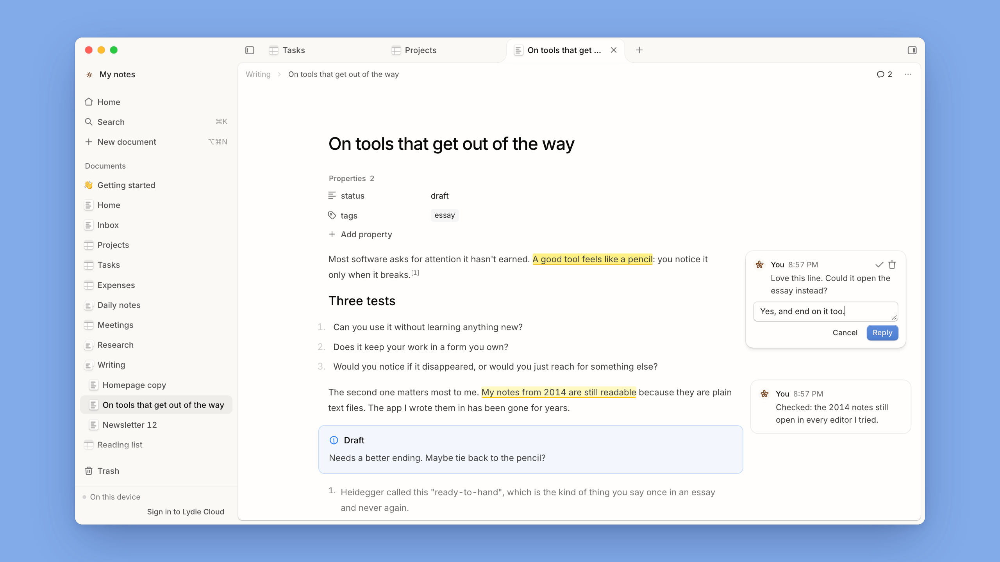

# Lydie

A writing app that works on a folder of Markdown files, or against a hosted workspace. Web and desktop
(Electron) from one React app.

**Lydie v2 is a ground-up rebuild, in alpha.** Expect rough edges and keep backups of your notes. The
old app (v1) is on the `main` branch.



## Running

Requires [Bun](https://bun.sh) 1.4 or later.

```bash
bun install
bun run dev:web     # http://localhost:3000
bun run check       # lint, format check, typecheck, tests, package boundaries
```

## Layout

- `packages/` libraries: contract, runtime, store, markdown, editor, ui, platform, plugin-api, app, and more
- `plugins/` built-in features, each a plugin that uses only `@lydie/plugin-api`
- `apps/` the web and desktop shells

See `AGENTS.md` for the package map and rules.

## Licence

AGPL-3.0 (see `LICENSE`). Packages marked MIT in `AGENTS.md` are MIT.
